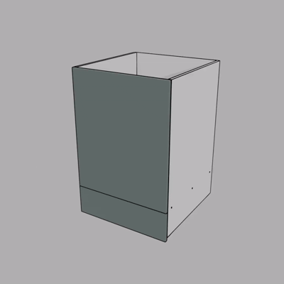
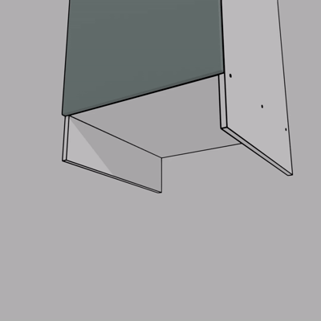
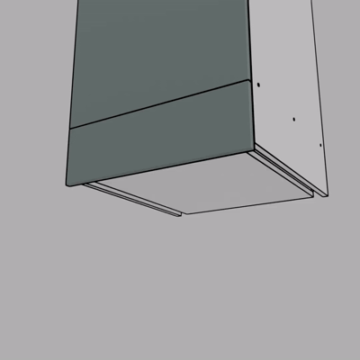
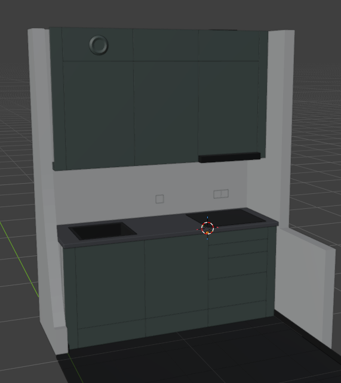
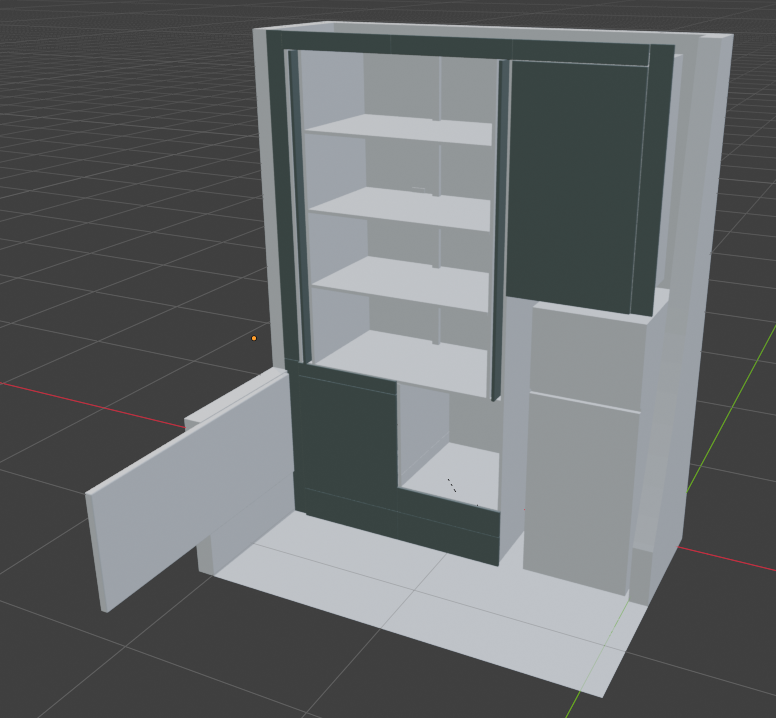

#  Cuisine gauche

## Bas

### Bas gauche

Planches fond rainurées à la defonceuse pour insérer une plaque de 3mm

-   Percer et insérer les tourillons dans la planche du bas
-   assembler et visser (pré-trou puis vis)
-   assembler plaque de fond
-   mettre la porte

### Bas droite

### Bas centre

### Tiroir inférieur + réglage

Réglage des supports de pieds

Installation sur le meuble des réglettes de tiroir

- Assemblage des tiroirs
- Fixation planches côté tiroir (lien avec les réglettes, laissant la place pour les supports)
- Accroche face avant tiroir

## Haut

### Haut droite

### Haut centre

### Haut gauche

##  Illustration

#  Cuisine droite

### Bas

### Haut

### Sur-frigo

### Frigo

##  Illustration

